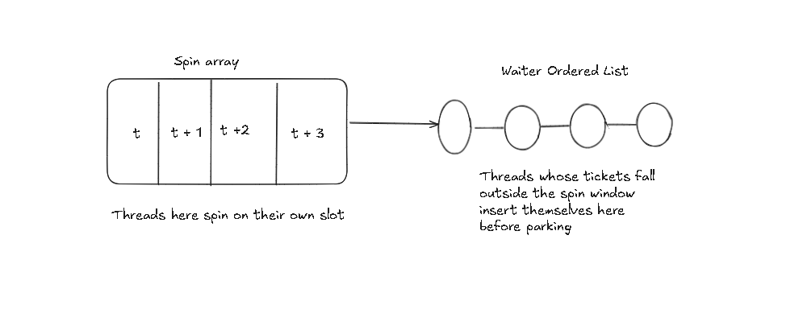

# Relaying wakeups in fair locks

A while back, I came across kprotty's post on [Batched Critical Sections (BCS)](https://kprotty.me/2025/09/08/batched-critical-sections.html), a concurrency pattern aimed at reducing scheduler overhead in fair locks.

With a traditional fair lock, ownership is handed to a specific waiting thread. This means that after being woken, that thread still needs to be scheduled before it can make progress. 

BCS took a different approach though. Instead of handing off ownership to another thread, the current owner executes updates on behalf of waiting threads before waking them.

I wanted to try something different. What if I kept the usual mutex semantics, but started waking threads before they were supposed to acquire the lock?

The idea is pretty simple. If I know which thread is going to acquire the lock several handoffs from now, why wait until then to wake it? I could just wake it ahead of time, it'd be running on the CPU before its turn. I called this idea `RelayLock`.


## How does it work?
To start with, there are three pieces to `RelayLock`: tickets, a spin array, and an ordered wait list.

Tickets provide a simple way for the lock to maintain fifo ordering between threads. 
A ticket based design in its simplest form contains two variables, `ticket` and `nowServing`, where `nowServing` allows threads to identify the ticket entitled to acquire the lock. 

However, having every waiting thread spin on `nowServing` would mean they all observe the same memory location being updated on every handoff, even when they're nowhere near acquiring the lock. Instead, the spin array gives each thread a slot associated with its ticket to spin on, so only the thread being handed the lock needs to observe a change.

---

**So what about threads whose tickets fall outside the spin window?** 

This is where the ordered wait list comes in. In short, it maps threads who fall outside the spin window to their tickets. It then allows the previous lock holder to find a waiter mapped to a ticket.

Visually, both structures together would look something like this.



Now that we've gone over the main structures needed for `RelayLock`, the algorithm should be pretty easy to follow.

### The algorithm

Acquiring the lock starts with a thread atomically claiming a ticket using fetch-and-add.

```java
int ourTicket = ticket.nextTicket();
```

It then checks where its ticket falls relative to `nowServing` to determine if it's in the spin window.

```java
boolean inSpinWindow = (ourTicket - nowServing) < spinArrayLength;
```

A thread that is already within the spin window spins on its slot until it is signalled, and returns.

```java
Slot s = spinArray[ourTicket & (spinArrayLength - 1)];
while(!s.isSignalled()) onSpinWait();
return;
```

Otherwise, it inserts itself into the wait list before parking. Once woken, it checks its ticket's position relative to `nowServing` again. If it has entered the spin window, it removes itself from the list and starts waiting on its slot.

```java
boolean parking = false;
for(;;) {
    if(inSpinWindow) {
        ...
        if (parking) waitList.remove(ourTicket);
        ...
    } else {
        if (!parking) {
            waitList.add(ourTicket);
            parking = true;
        } else {
            park();
        }  
    }
}          
```

Unlocking is simpler. The current owner advances `nowServing` by one, signals the next slot, and looks up the waiter at the back of the current spin window.

```java
    int ourTicket = nowServing; 
    var nextTicket = ourTicket + 1;
    Slot next = spinArray[nextTicket & (spinArrayLength - 1)];
    nowServing.set(nextTicket);
    next.signal(); //handoff to next waiter

    //this is the ticket that should enter the spin window after this handoff
    int lookahead = ourTicket + spinArrayLength;
    Thread waiter = waitList.get(lookahead);
```


If a waiter mapped to that ticket is present in the wait list, it is unparked.

```java
//If the waiter is present, unpark
if (waiter != null) unpark(waiter);
```

That's the whole algorithm. 
Also, notice that the thread being unparked doesn't necessarily acquire the lock next. We only try to get it running ahead of time.

## How does it perform?

I wrote a benchmark in JMH consisting of a short and medium sized critical section to compare `RelayLock` against the JDK's fair `ReentrantLock`, which is a custom CLH lock. I also included a BaselineRelayLock as a control implementation, which removes the wake ahead aspect of `RelayLock`.

Going in, I expected the performance of `RelayLock` would depend on two things: the cost of the critical section and the length of the spin array.

My reasoning was that the longer the spin window, the more time a thread has to get scheduled before it's actually supposed to acquire the lock. So I expected `RelayLock` to perform similarly to a traditional fair lock when the time spent processing the threads in the spin window was roughly equal to the time needed for the OS to schedule a thread back onto the CPU.

However, `RelayLock` performed considerably better than both baselines in both benchmarks, even when the spin window wasn't large enough to cover the scheduler overhead.

The difference between `RelayLock` and `BaselineRelayLock`was particularly noticeable. This part actually matters a lot since it shows that simply relaying wakeups ahead of time seems to make a substantial difference, even without a particularly large lookahead window.

The cost of the critical section also didn't have as much impact as I expected. Both benchmarks behaved pretty similarly, with scheduler overhead still dominating the time spent waiting for the lock.

Apparently, looks like my initial hypothesis was wrong and you don't actually need a relatively large spin window to get a benefit from relaying wakeups (relative to my baseline). At least for these workloads, a relatively small spin window was enough to outperform both baselines.

So, `RelayLock` ended up performing much better than I expected, but there are still some downsides. Though depends if you consider them downsides.

First, we're waking threads that aren't necessarily going to acquire the lock immediately. We're moving some of the scheduling overhead out of the handoff, but that also means having threads become runnable before they can actually do anything useful. Threads in the spin array also never park, so they can end up burning CPU while waiting for their turn. Depending on the workload, particularly when oversubscription is common, these can become pretty significant footguns.

`RelayLock` is definitely not a better general-purpose lock than `ReentrantLock`. But if FIFO ordering matters, scheduler overhead makes up a significant part of lock handoff, and a lock is still the right primitive for the job, relaying wakeups ahead of time (pun intended) is an interesting alternative.

## The end?
Finally, if you're interested in the actual implementation or just want to check the benchmarks, you can check that out [here](https://github.com/kusoroadeolu/locks)

Also, you can check out a more established pattern known as **Flat Combining** that I built and is quite similar to BCS [here](https://github.com/kusoroadeolu/fose)